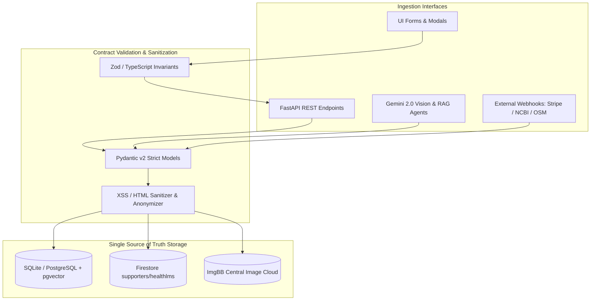

# TeachMeHealthcare — Data Contracts & System Integrity Specification
**Status**: APPROVED & IMMUTABLE SINGLE SOURCE OF TRUTH  
**App Tag**: `healthlms`  
**System Version**: 2.4.0  
**Effective Date**: October 15, 2026  
**Jurisdiction Compliance**: Australian Privacy Act 1988 (APPs), Health Records Act 2001 (Vic), My Health Records Act 2012, GDPR (EU 2016/679), PCI DSS v4.0 (SAQ A)

---

## 1. System Integrity Architecture & Boundary Definition

TeachMeHealthcare (`healthlms`) provides a cloud-native educational medical imaging and collaborative diagnostic training platform designed for healthcare professionals, educators, and students in remote and regional communities worldwide.

To guarantee systemic integrity, prevent schema drift, and secure sensitive medical, financial, and personal data, **every data ingestion interface** (UI forms, REST API request bodies/query params, and AI Agent tool calls/extraction slots) is bound by the contractual specifications detailed below.



---

## 2. Domain Entities & Comprehensive Data Schemas

### Domain 1: User & Supporter Identity Domain

```
Channel: UI (AuthModal, SupporterProfileModal) | API (/api/auth/*) | Firebase Google OAuth
Primary Role: "supporter" (Default on Google OAuth registration)
Multi-Tenancy Tag: "healthlms" (Enforced across all records)
Dual Auth Principle: Single Gmail/Workspace account linked to Google OAuth UID with optional fallback password
```

| Field Name | Type | Ingestion Channel | Data Classification | Regulatory Tagging | Boundary & Invariant Constraints | Sanitization & Normalization | Target Storage & Indexing | Retention / Lifecycle |
| :--- | :--- | :--- | :--- | :--- | :--- | :--- | :--- | :--- |
| `email` | `EmailStr` (String) | UI Form / API Route / Google OAuth | **PII** | APP 3.2, APP 6, GDPR Art 6(1)(a) | Valid RFC 5322 email; length: 5–255 chars. Primary key identifier for Gmail / Google Workspace account. | Lowercased, whitespace trimmed, verified domain syntax. | `users.email` (Unique Index, `VARCHAR(255)`) | Active until account deletion request (Right to Erasure). |
| `password` | `Optional[String]` | UI Form / API Route | **Internal / Auth Secret** | APP 11.1, GDPR Art 32 | **Strictly Optional** secondary backup password. If supplied: min length 6 chars, max 128 chars. Null if user solely relies on Google OAuth. | Never stored in plaintext; hashed via Argon2id / bcrypt with individual cryptographic salt. | `users.hashed_password` (`VARCHAR(255)`) | Retained with account; overwritten on password reset. |
| `full_name` | `String` | UI Form / API Route / Google Profile | **PII** | APP 3.2, GDPR Art 6 | Required; min 1 char, max 255 chars. Letters, spaces, hyphens, apostrophes allowed. | Stripped of HTML tags; trimmed of leading/trailing spaces. | `users.full_name` (`VARCHAR(255)`) | Active lifecycle. |
| `role` | `Enum` | Internal / API Route | **Internal** | RBAC Security Policy | One of: `supporter`, `doctor`, `student`, `admin`. Automatically set to `supporter` for Google OAuth registrations. | Cast to lowercase string; validated against strict enum whitelist. | `users.role` (`VARCHAR(20)`) | Active lifecycle. |
| `phone_number` | `Optional[String]` | UI Form / API Route | **PII** | APP 3.2, APP 6 | Optional. If provided: E.164 international format or standard Australian national format `^(\+?61\|0)[2-478](?:[ -]?[0-9]){8}$`. Max 50 chars. | Stripped of redundant formatting characters except leading `+`. | `users.phone_number` (`VARCHAR(50)`, Nullable) | Active lifecycle. |
| `address` | `Optional[String]` | UI Form / API Route | **PII** | APP 3.2, APP 6 | Optional. Physical street, suburb, state, postcode, or country. Max 500 chars. | HTML escaped, trimmed. | `users.address` (`VARCHAR(500)`, Nullable) | Active lifecycle. |
| `supporter_comments` | `Optional[String]` | UI Form / API Route | **PII / User Input** | APP 3.2, APP 6 | Optional comment box for details users wish to share. Max 2,000 chars. | Full HTML sanitization (DOMPurify / bleach), control characters stripped. | `users.supporter_comments` (`VARCHAR(2000)`, Nullable) | Active lifecycle. |
| `app_tag` | `String` | Injected Default | **Internal** | Tenancy Isolation | Invariant value: `"healthlms"`. Rejects any conflicting string. | Uppercase/lowercase normalized to `"healthlms"`. | `users.app_tag` (`VARCHAR(50)`, Default `"healthlms"`) | Immutable. |
| `firebase_uid` | `Optional[String]` | Google OAuth / API Route | **Internal** | APP 11, GDPR Art 32 | Unique Firebase Auth identifier (1–128 chars). Maps Google OAuth session directly to database user record. | Trimmed alphanumeric string. | `users.firebase_uid` (Unique Index, `VARCHAR(128)`, Nullable) | Active lifecycle. |
| `is_verified` | `Boolean` | Auth Provider | **Internal** | Identity Verification | Default `True` for Google OAuth and verified supporter accounts. | Strict boolean cast (`true` / `false`). | `users.is_verified` (`BOOLEAN`, Default `TRUE`) | Active lifecycle. |

---

### Domain 2: Medical Imaging & Diagnostic Scans Domain

```
Channel: UI (DiagnosticViewer, RelatedScansPanel) | API (/api/images/*) | ImgBB Cloud Storage
Storage Location: Central ImgBB album (https://ibb.co/album/TKRnX5) & Backend File Cache
Privacy Mandate: Zero Un-anonymized Protected Health Information (PHI). Mandatory EXIF / DICOM de-identification.
```

| Field Name | Type | Ingestion Channel | Data Classification | Regulatory Tagging | Boundary & Invariant Constraints | Sanitization & Normalization | Target Storage & Indexing | Retention / Lifecycle |
| :--- | :--- | :--- | :--- | :--- | :--- | :--- | :--- | :--- |
| `title` | `String` | Form Data / API Route | **Public / Educational** | Health Records Act 2001 (Vic) | Required. Min 3 chars, max 255 chars. Describes clinical case (e.g., "Right Lower Lobe Pneumonia"). | HTML escaped, trimmed. | `medical_images.title` (`VARCHAR(255)`) | Permanent educational archive. |
| `file` | `Binary Upload` | Multipart Form / UploadFile | **Sensitive / Health Data** | Health Records Act 2001, HIPAA Safe Harbor | Supported MIME types: `image/jpeg`, `image/png`, `image/webp`, `application/dicom`. Max file size: 50MB. | DICOM tags stripped of 18 HIPAA patient identifiers (Name, MRN, DOB, Address). EXIF metadata cleared. | `medical_images.file_path` (`VARCHAR(500)`), hosted at ImgBB | Permanent educational archive. |
| `modality` | `Enum` | Form Data / Query Param | **Public** | Clinical Taxonomy | Strict enum: `xray`, `mri`, `ct`, `ultrasound`, `other`. | Lowercased, checked against immutable whitelist. | `medical_images.modality` (`VARCHAR(20)`, Indexed) | Permanent archive. |
| `body_region` | `String` | Form Data / Query Param | **Public** | SNOMED CT / Anatomy | Required. Min 2 chars, max 255 chars (e.g., "Thorax / Lungs", "Brain Axial", "Musculoskeletal"). | Trimmed, title-cased. | `medical_images.body_region` (`VARCHAR(255)`, Indexed) | Permanent archive. |
| `description` | `Optional[String]` | Form Data / API Route | **Public / Educational** | Clinical Context | Optional. Max 5,000 chars. Educational history and clinical context. | HTML tags stripped, trimmed. | `medical_images.description` (`TEXT`, Nullable) | Permanent archive. |
| `is_anonymized` | `Boolean` | Form Data / API Route | **Compliance Flag** | APP 11.2, Privacy Act 1988 | Must be `True` before any public educational presentation or student classroom session. | Invariant validation: Rejects upload if `False` on public feeds. | `medical_images.is_anonymized` (`BOOLEAN`, Default `FALSE`) | Permanent audit trail. |
| `ai_analysis` | `Optional[String]` | AI Agent Output | **Educational AI Report** | Australian TGA Software-as-a-Medical-Device (SaMD) Disclaimer | Cached text output from Gemini Vision analysis. Includes mandatory educational disclaimer. | Strict markdown sanitization, no unescaped script blocks. | `medical_images.ai_analysis` (`TEXT`, Nullable) | Cached with scan; re-generable on prompt update. |

---

### Domain 3: Clinical Annotations, Caliper Measurements & Finding Types

```
Channel: UI (DiagnosticViewer Calipers & Pins) | API (/api/images/{id}/annotations)
Author Restriction: Doctors & Verified Educators (require_doctor dependency)
```

| Field Name | Type | Ingestion Channel | Data Classification | Regulatory Tagging | Boundary & Invariant Constraints | Sanitization & Normalization | Target Storage & Indexing | Retention / Lifecycle |
| :--- | :--- | :--- | :--- | :--- | :--- | :--- | :--- | :--- |
| `finding_type` | `Enum` | UI Selector / API Route | **Sensitive / Clinical** | Clinical Finding Classification | Strict enum: `fracture`, `dislocation`, `ligament_tear`, `soft_tissue`, `degenerative`, `tumor`, `infection`, `normal`, `other`. | Validated against backend enum set. | `annotations.finding_type` (`VARCHAR(50)`, Indexed) | Retained with parent medical image. |
| `finding_description` | `String` | UI Form / API Route | **Sensitive / Clinical** | Clinical Finding Description | Required. Min 5 chars, max 5,000 chars. | HTML escaped, trimmed. | `annotations.finding_description` (`TEXT`) | Retained with parent image. |
| `severity` | `Optional[Enum]` | UI Selector / API Route | **Sensitive / Clinical** | Clinical Severity Index | One of: `mild`, `moderate`, `severe`. Null allowed. | Lowercased string enum. | `annotations.severity` (`VARCHAR(20)`, Nullable) | Retained with parent image. |
| `location_on_image` | `Optional[String]` | Caliper / Pin Canvas Tool | **Clinical Spatial Data** | DICOM Coordinates | Normalized percentage or millimeter coordinates JSON (e.g., `{"x": 42.5, "y": 68.1, "distance_mm": 24}`). | Strict JSON parsing or bounded coordinate validation `(0.0 <= x, y <= 100.0)`. | `annotations.location_on_image` (`VARCHAR(255)`, Nullable) | Retained with parent image. |
| `clinical_notes` | `Optional[String]` | UI Textarea / API Route | **Sensitive / Clinical** | Educational Differential Notes | Optional. Max 10,000 chars. | Sanitized text, markdown supported. | `annotations.clinical_notes` (`TEXT`, Nullable) | Retained with parent image. |

---

### Domain 4: Collaborative Classroom & Multimodal Caseroom Chat

```
Channel: UI (CollaborativeCaseroom) | API (/api/images/{id}/comments)
Participants: Students, Physicians, Teachers
Structure: Threaded hierarchy via parent_id
```

| Field Name | Type | Ingestion Channel | Data Classification | Regulatory Tagging | Boundary & Invariant Constraints | Sanitization & Normalization | Target Storage & Indexing | Retention / Lifecycle |
| :--- | :--- | :--- | :--- | :--- | :--- | :--- | :--- | :--- |
| `content` | `String` | UI Input / API Route | **Internal / Discussion** | APP 3.2, APP 6 | Required. Min 1 char, max 2,000 chars. Cannot be empty or whitespace only. | Stripped of malicious HTML/JS payloads; text trimmed. | `comments.content` (`TEXT`) | 7 years from session archive (educational audit). |
| `image_id` | `Integer` | Path / Foreign Key | **Internal** | Data Relational Integrity | Must match active `medical_images.id`. | Positive integer cast. | `comments.image_id` (FK to `medical_images.id`, Indexed) | Cascades on image delete. |
| `parent_id` | `Optional[Integer]` | UI Reply Action / API Route | **Internal** | Threaded Tree Integrity | Must match existing comment ID on the *same* `image_id`. Null for root message. | Nullable integer. Rejects circular parent loops. | `comments.parent_id` (FK to `comments.id`, Indexed) | Cascades on parent delete. |

---

### Domain 5: AI Vision Analysis, RAG & Vector Embeddings Domain

```
Engine: Google Gemini 2.0 Flash (Vision & Chat) + models/text-embedding-004 (768 Dimensions)
Channel: AI Agent Tool / API (/api/ai/*, /api/search/*)
Integrity Invariant: Zero diagnostic guarantees. Mandatory educational disclaimer on all outputs.
```

| Field Name | Type | Ingestion Channel | Data Classification | Regulatory Tagging | Boundary & Invariant Constraints | Sanitization & Normalization | Target Storage & Indexing | Retention / Lifecycle |
| :--- | :--- | :--- | :--- | :--- | :--- | :--- | :--- | :--- |
| `question` | `String` | UI Search / API Route (`/api/ai/ask`) | **Internal / Query** | APP 6, User Prompt | Required. Min 2 chars, max 1,000 chars. | Trimmed, PII redaction filter applied before embedding generation. | In-memory during query processing; temporary query log. | Transient (session duration). |
| `embedding` | `Array[Float]` | AI Service Pipeline | **Internal Derived Vector** | Model Representation | Array of exactly 768 floating-point numbers (`text-embedding-004`). | Unit-normalized vector. Values bounded `[-1.0, 1.0]`. | `embeddings.embedding` (`TEXT` JSON serialization / pgvector `vector(768)`) | Re-indexed on model version changes. |
| `content_type` | `Enum` | AI Pipeline | **Internal Metadata** | Knowledge Base Type | Strict enum: `annotation`, `comment`, `ai_analysis`. | Lowercase string. | `embeddings.content_type` (`VARCHAR(20)`, Indexed) | Bound to source record. |
| `similarity_score` | `Float` | Vector Cosine Distance | **Computed Metric** | Cosine Similarity | Range: `0.000` to `1.000`. Higher represents closer semantic alignment. | Formatted to 4 decimal places. | Computed dynamically in SQL / in-memory. | Ephemeral response payload. |
| `ai_disclaimer` | `String` | Injected System Prompt | **Compliance / Safety** | Australian TGA SaMD Guidance, FDA Education Policy | Immutable notice: *"⚠️ IMPORTANT: This analysis is for educational purposes only. Always recommend professional medical review for any clinical decisions."* | Injected into all prompt headers and response payloads. | Immutable application constant. | Permanent. |

---

### Domain 6: Supporter Billing & Stripe Contributions Domain

```
Channel: UI (SupporterProfileModal) | API (/api/supporter/*) | Stripe Checkout Sessions API
Compliance: PCI DSS v4.0 SAQ A Compliant (100% Hosted Fields — No PAN/CVV Touches Application)
Default Currency: AUD (Australian Dollars)
```

| Field Name | Type | Ingestion Channel | Data Classification | Regulatory Tagging | Boundary & Invariant Constraints | Sanitization & Normalization | Target Storage & Indexing | Retention / Lifecycle |
| :--- | :--- | :--- | :--- | :--- | :--- | :--- | :--- | :--- |
| `amount_cents` | `Integer` | UI Form / API Route | **Financial** | PCI DSS Scope, Australian GST | Min: 500 cents ($5.00 AUD); Max: 1,000,000 cents ($10,000 AUD). Integer only. | Strict integer cast; prevents fractional cent injection. | Stripe Checkout Session Metadata / Financial audit logs. | 7 years (Australian Taxation Office - ATO compliance). |
| `currency` | `String` | Form / Injected | **Financial** | Currency Standard ISO 4217 | Default `"aud"`. Supports `"aud"`, `"usd"`, `"eur"`, `"gbp"`, `"nzd"`. | Lowercased, verified 3-letter ISO code. | Stripe Session Payload. | 7 years. |
| `supporter_name` | `Optional[String]` | UI Input / API Route | **PII** | Australian Privacy Act | Supporter name for receipt generation. Max 255 chars. | Trimmed, HTML escaped. | Stripe Customer / Session Metadata. | 7 years. |
| `supporter_email` | `Optional[EmailStr]` | UI Input / API Route | **PII** | Tax Receipt Compliance | Valid RFC 5322 email for electronic donation receipt delivery. | Lowercased, trimmed. | Stripe Customer Record. | 7 years. |
| `app_tag` | `String` | Injected Metadata | **Internal Tag** | Billing Attribution | Value: `"healthlms"`. Injected into Stripe session metadata `metadata[app_tag]`. | Verified match with `healthlms`. | Stripe Metadata Dictionary. | Permanent. |

---

### Domain 7: Geolocation, Regional News & Academic Research Domain

```
Channel: UI (GeolocationModal, LocalizedRegionalNews, AcademicResearch) | OpenStreetMap | NCBI PubMed
Compliance: APP 3.2, APP 5 (Coarse Geotagging for Regional News Matching)
Privacy Invariant: No high-precision micro-tracking. Coordinates rounded to 2 decimal places (~1.1km coarse accuracy).
```

| Field Name | Type | Ingestion Channel | Data Classification | Regulatory Tagging | Boundary & Invariant Constraints | Sanitization & Normalization | Target Storage & Indexing | Retention / Lifecycle |
| :--- | :--- | :--- | :--- | :--- | :--- | :--- | :--- | :--- |
| `suburb` | `String` | UI Input / Reverse Geocode | **PII / Location (Coarse)** | APP 3.2, APP 5 | Australian or international locality name. Max 100 chars (e.g., "Parkwood", "Melbourne"). | Trimmed, title-cased. | `localStorage: tmh_geo_settings.suburb` | Local client device storage only. |
| `state` | `String` | UI Selector / Geocode | **Location (Coarse)** | Regional Health Tagging | Australian state code (`VIC`, `NSW`, `QLD`, `WA`, `SA`, `TAS`, `ACT`, `NT`) or `OTHER`. | Uppercase 2–5 char string. | `localStorage: tmh_geo_settings.state` | Client device storage. |
| `postcode` | `String` | UI Input / Geocode | **Location (Coarse)** | Postal Routing | 4 digits for Australia `^[0-9]{4}$`, or max 12 chars international. | Trimmed string. | `localStorage: tmh_geo_settings.postcode` | Client device storage. |
| `country` | `String` | UI Input / Geocode | **Location** | Jurisdiction Tag | Default `"Australia"`. Max 100 chars. | Trimmed string. | `localStorage: tmh_geo_settings.country` | Client device storage. |
| `timezone` | `String` | Browser / UI Selector | **Preferences** | IANA Timezone Database | Valid IANA timezone (e.g., `"Australia/Melbourne"`, `"Australia/Brisbane"`). | Whitelist verified against IANA timezone list. | `localStorage: tmh_geo_settings.timezone` | Client device storage. |
| `dateFormat` | `Enum` | UI Selector | **Preferences** | Date Representation | Strict enum: `"DD/MM/YYYY"`, `"MM/DD/YYYY"`, `"YYYY-MM-DD"`. Default `"DD/MM/YYYY"`. | Strict enum match. | `localStorage: tmh_geo_settings.dateFormat` | Client device storage. |
| `timeFormat` | `Enum` | UI Selector | **Preferences** | Time Representation | Strict enum: `"12h"`, `"24h"`. Default `"12h"`. | Strict enum match. | `localStorage: tmh_geo_settings.timeFormat` | Client device storage. |
| `latitude` / `longitude` | `Optional[Float]` | Browser Geolocation API | **Sensitive Location** | APP 3.2 (Explicit Consent) | Coarse coordinates. Latitude: `[-90.0, 90.0]`, Longitude: `[-180.0, 180.0]`. | Truncated to 2 decimal places to protect user residential privacy. | Client device storage only. Never transmitted to persistent backend tables. | Ephemeral client storage. |
| `pmid` | `String` | NCBI Academic Integration | **Public Citation** | Academic Attribution | PubMed unique identifier (1–10 numeric digits). Links to `https://www.ncbi.nlm.nih.gov/pubmed/{pmid}`. | Numeric string regex `^[0-9]{1,10}$`. | `academic_articles.pmid` | Permanent reference. |

---

## 3. Regulatory Compliance & Data Governance Matrix

| Framework | Governing Body | Platform Implementation & Technical Safeguards |
| :--- | :--- | :--- |
| **Australian Privacy Principles (APPs)** | Office of the Australian Information Commissioner (OAIC) | - **APP 3**: Collection of personal details (Name, Phone, Address, Comments) strictly restricted to registered supporters with voluntary consent.<br>- **APP 6**: Personal details used solely for supporter communication, receipts, and classroom identification; zero third-party data broker disclosures.<br>- **APP 11**: All passwords hashed using Argon2id/bcrypt; HTTPS/TLS 1.3 enforced on all REST endpoints; Firestore database rules restricted by user UID. |
| **Health Records Act 2001 (Vic) & HIPAA Safe Harbor** | Australian State Health Commissioners / HHS | - **Strict De-Identification**: No direct patient identifiers stored. All medical images must have `is_anonymized = True` before educational publishing.<br>- **DICOM Metadata Scrubbing**: Patient name, medical record numbers (MRN), dates of birth, and institution tags are stripped prior to ImgBB upload.<br>- **Educational Scope**: System explicitly labeled as an educational simulator; not a diagnostic clinical decision support device. |
| **PCI DSS v4.0 (SAQ A Scope)** | Payment Card Industry Security Standards Council (PCI SSC) | - **Zero Cardholder Storage**: Card numbers (PAN), CVVs, and expiration dates never touch or traverse the TeachMeHealthcare application servers.<br>- **Stripe Hosted Checkout**: Payment sessions are generated server-side via encrypted tokenization and completed exclusively on Stripe's PCI DSS Level 1 certified infrastructure. |
| **General Data Protection Regulation (GDPR)** | European Data Protection Board (EDPB) | - **Article 6(1)(a) & Article 9(2)(a)**: Explicit consent collected upon registration for processing educational analytics.<br>- **Article 17 (Right to Erasure)**: Supported through user deletion endpoints which cascade across comments, supporter records, and session data. |

---

## 4. Architectural Invariants & Failure Modes

1. **Google OAuth & Secondary Password Linking Invariant**:
   - A single email address represents exactly one supporter record across Firebase Auth, Firestore, and the backend SQL database.
   - Supporter registration via Google OAuth automatically assigns `role = "supporter"` and `app_tag = "healthlms"`.
   - The secondary password field is **optional**. If omitted, the account is fully functional via Google OAuth. If provided, it is securely hashed and stored to provide an uninterrupted secondary login channel if Google OAuth services are unavailable in remote environments.
2. **Multi-Tenancy Invariant (`healthlms`)**:
   - Every user, medical image, supporter contribution, and Stripe checkout session must carry `app_tag: "healthlms"`.
   - API endpoints must reject or default missing tags to `"healthlms"`.
3. **Medical Image Storage Invariant**:
   - ImgBB album `https://ibb.co/album/TKRnX5` is the immutable primary image host for high-resolution medical scans.
   - Thumbnails are generated locally and cached to optimize low-bandwidth mobile connectivity in remote clinics.
4. **AI Hallucination & Safety Boundary**:
   - Gemini Vision and RAG queries are constrained by system prompts strictly forbidding definitive diagnostic claims.
   - Every AI response automatically carries the standardized educational safety alert.
   - Vector similarity scores below `0.65` trigger fallback educational guidance rather than speculative diagnostic answers.

---

## 5. Specification Sign-Off & Maintenance
- **Data Architect**: Antigravity System Integrity Engine
- **Platform**: TeachMeHealthcare (`teach-me-health`)
- **Persistence Path**: `d:\Agy\teach-me-health\data-contracts.md`
- **Revision Policy**: Immutable. Any breaking schema change requires a formal migration RFC, updated Pydantic schemas, and explicit version incrementation.
